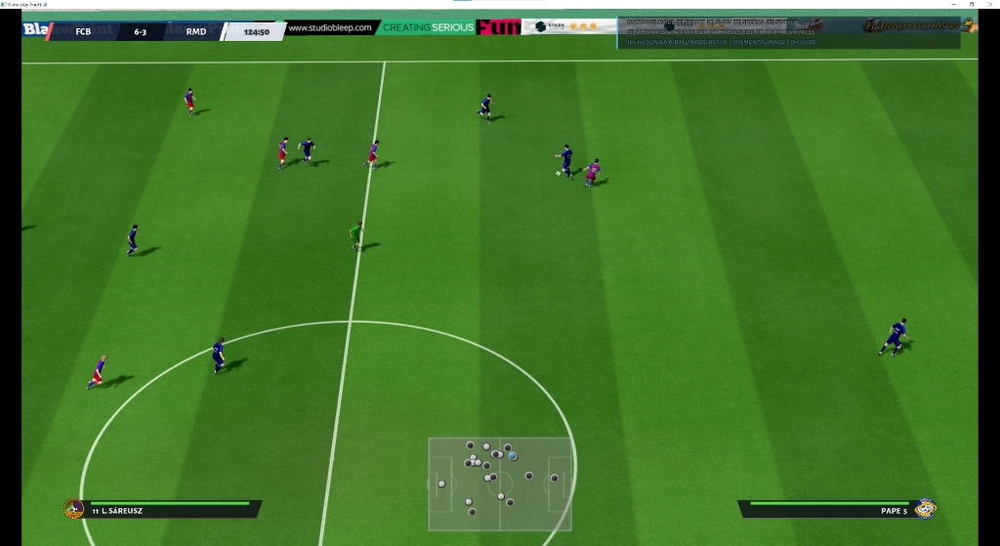

# Gameplay Football (Modernized Edition)



A modernized C++17 / 64-bit fork of [GameplayFootball](https://github.com/BazkieBumpercar/GameplayFootball) originally created by [Bastiaan Konings Schuiling](http://www.properlydecent.com/), incorporating improvements from [Google Research Football](https://github.com/google-research/football) and [vi3itor/GameplayFootball](https://github.com/vi3itor/GameplayFootball) while preserving full interactive menus, match presentation, audio, and controller gameplay.

---

## Key Highlights & Enhancements

- **Modernized 64-bit Engine & Asset Pipeline**
  - Native `x64` C++17 build with main-thread SDL2 + OpenGL 3.2+ Core context affinity.
  - Built-in **glTF 2.0 (`.glb`)** geometry & skeletal animation loader alongside legacy `.ase` support, plus GPU vertex skinning.
- **Deferred Rendering & Multi-Level Anti-Aliasing**
  - Natural stadium hemisphere lighting, SSAO, filmic highlight rolloff, and sRGB perceptual post-processing.
  - Live-switchable **Anti-Aliasing (`[F10]` in-game or `Settings -> Graphics`)**:
    - `OFF` — Raw 1:1 pixels
    - `FXAA Fast` — Ultra-lightweight directional edge smoothing for maximum FPS on low-end GPUs
    - `FXAA Quality` *(Default)* — 12-step FXAA 3.11 tangent search + G-Buffer silhouette detection + Contrast-Adaptive Sharpening (CAS) for crisp turf
    - `Ultra (SSAA + FXAA)` — `1.35x` 4-tap Rotated-Grid Super-Sampling (RGSS) + FXAA Quality + CAS
  - Instant **Borderless Fullscreen (`[F11]` / `Alt+Enter`)** and live resolution switching without restarting.
- **Broadcast-Style Match HUD**
  - Top-left broadcast scoreboard & match timer.
  - Bottom-left / bottom-right side-assigned active player nameplates (dynamically matching each team's pitch half) with live stamina bars.
  - Translucent pitch radar and toggleable `[F9]` quick controls bar.
- **Low-Spec Performance Optimizations**
  - 1ms Windows scheduler resolution, condition-variable worker thread wakeups (zero busy-wait CPU spin), cached shader uniform locations, dirty-tracked 2D HUD surfaces, and allocation-free per-frame render/AI queues.
- **AI & Tactical Inspection**
  - 360° `MentalImage` perception with live **`[F7]` MentalImage Inspector** overlay, plus Sandbox & Free-Kick training modes.

---

## In-Game Shortcuts

| Key | Action |
| --- | --- |
| `F11` / `Alt+Enter` | Toggle Borderless Fullscreen |
| `F10` | Cycle Anti-Aliasing (`OFF` -> `FXAA Fast` -> `FXAA Quality` -> `Ultra`) |
| `F9` | Show / Hide top controls bar |
| `F7` | Toggle AI `MentalImage` tactical inspector |
| `F1` – `F6` | Debug / Camera / Ball / Mode / Reset / IK tools |

---

## Building from Source (Windows x64)

### Prerequisites
- [Git](https://git-scm.com/download/win)
- [Visual Studio 2022](https://visualstudio.microsoft.com/downloads/) (or Build Tools for Visual Studio 2022) with **Desktop development with C++** and **C++ CMake tools for Windows**
- [vcpkg](https://github.com/microsoft/vcpkg)

### Configure & Build
```powershell
git clone https://github.com/manhtuanphoto/GameplayFootball.git
cd GameplayFootball

# Configure 64-bit build with vcpkg toolchain
cmake -S . -B build_x64 -G "Visual Studio 17 2022" -A x64 `
  -DCMAKE_TOOLCHAIN_FILE="$env:VCPKG_ROOT/scripts/buildsystems/vcpkg.cmake" `
  -DVCPKG_TARGET_TRIPLET=x64-windows

# Compile Release binary
cmake --build build_x64 --config Release --parallel 8

# Copy game data into the runtime folder on first setup
Copy-Item -Path "data\*" -Destination "build_x64\Release" -Recurse -Force
```

### Run the Game
```bat
run_game.bat
```

---

## Building from Source (Linux)

Install required dependencies:
```bash
sudo apt-get install git cmake build-essential libgl1-mesa-dev libsdl2-dev \
  libsdl2-image-dev libsdl2-ttf-dev libsdl2-gfx-dev libopenal-dev libboost-all-dev \
  libsqlite3-dev
```

Compile and run:
```bash
git clone https://github.com/manhtuanphoto/GameplayFootball.git
cd GameplayFootball
mkdir -p build && cp -R data/. build
cd build
cmake ..
make -j$(nproc)
./gameplayfootball
```

---

## Credits & License

- Original game by **Bastiaan Konings Schuiling** ([ProperlyDecent](http://www.properlydecent.com/))
- Updates from [Google Research Football](https://github.com/google-research/football) & [vi3itor/GameplayFootball](https://github.com/vi3itor/GameplayFootball)
- Licensed under the [Apache License 2.0](LICENSE)
